  

  

    
    
    
    
  

  

I learn by rebuilding the things most people import: a language, a database, an HTTP server, a voxel engine. Most of what lives here started as "how hard could it be?"

## 🔨 Built from scratch

<table>
  <tr>
    <td width="50%" valign="top">
      <h3>🌙 <a href="https://github.com/aag2807/lunar">Lunar</a></h3>
      
A statically-typed superset of Lua that compiles to clean Lua. TypeScript, but for Lua. Compiler written in Go.

      
<code>Go</code> <code>Lua</code> <code>compilers</code>

    </td>
    <td width="50%" valign="top">
      <h3>🧱 <a href="https://github.com/aag2807/VoxCraft">VoxCraft</a></h3>
      
A voxel engine with chunk management, greedy meshing, vertex pooling, multithreaded terrain, and ray casting.

      
<code>C++</code> <code>SDL2</code> <code>graphics</code>

    </td>
  </tr>
  <tr>
    <td width="50%" valign="top">
      <h3>ᛟ <a href="https://github.com/aag2807/rune-3D">RUNE</a></h3>
      
A retro raycasting engine with DDA wall rendering, first-person movement, and animated weapons.

      
<code>Odin</code> <code>Raylib</code> <code>raycasting</code>

    </td>
    <td width="50%" valign="top">
      <h3>🌑 <a href="https://github.com/aag2807/eclipse">Eclipse</a></h3>
      
A small Blazor-like WebAssembly UI framework using Lua. Because why not.

      
<code>Lua</code> <code>WebAssembly</code> <code>frameworks</code>

    </td>
  </tr>
  <tr>
    <td width="50%" valign="top">
      <h3>🗄️ <a href="https://github.com/aag2807/DummyDB">DummyDB</a></h3>
      
A database built to learn how databases work: SQL parser plus insert, update, delete, and where clauses.

      
<code>databases</code> <code>parsers</code>

    </td>
    <td width="50%" valign="top">
      <h3>🌐 <a href="https://github.com/aag2807/odin-http-server">Odin HTTP Server</a></h3>
      
An HTTP server from raw sockets, to understand what libraries hide.

      
<code>Odin</code> <code>networking</code>

    </td>
  </tr>
  <tr>
    <td width="50%" valign="top">
      <h3>⚡ <a href="https://github.com/aag2807/zed-razor-cshtml-pages">Razor Pages for Zed</a></h3>
      
Syntax highlighting, IntelliSense, and go-to-definition for ASP.NET Razor and Blazor in the Zed editor.

      
<code>tree-sitter</code> <code>LSP</code> <code>tooling</code>

    </td>
    <td width="50%" valign="top">
      <h3>👾 <a href="https://github.com/aag2807/chip-8-clang">CHIP-8</a></h3>
      
A CHIP-8 emulator in C. The classic first step into emulation.

      
<code>C</code> <code>emulation</code>

    </td>
  </tr>
</table>

More experiments: [lua-jsx-transpiler](https://github.com/aag2807/lua-jsx-transpiler) · [triplex-to-go](https://github.com/aag2807/triplex-to-go) · [leetcode-odin](https://github.com/aag2807/leetcode-odin) · [vanilla-php-crud](https://github.com/aag2807/vanilla-php-crud) · [TheBookStore](https://github.com/aag2807/TheBookStore)

## 🚧 On the workbench

- 🦀 **Strata**: a Minecraft-style voxel engine in Rust with wgpu, built to learn the language the hard way
- 🃏 **A Lovecraftian card duel engine** in Zig with raylib
- 🎮 **A C game engine** (OpenGL, Lua scripting) for a momentum platformer
- 🤖 **GraceOS**: a self-hosted AI agent, named after Grace Hopper

## 🧰 Toolbox

**Pays the bills**

  

**Keeps me up at night**

  
  

**Daily drivers**

  

## 🐍 Contributions

  <picture>
    <source media="(prefers-color-scheme: dark)" srcset="https://raw.githubusercontent.com/aag2807/aag2807/output/snake-dark.svg"/>
    
  </picture>

  

